 

**I design and build modern web systems end to end, from backend architecture and APIs to responsive, polished frontends.**

 

## What I do

- **Full-stack web apps** with the MERN stack, Next.js and Laravel
- **APIs and backends**: REST and GraphQL, authentication, databases
- **Frontends people enjoy using**: responsive, accessible, animated with care
- **AI-powered products**: personalised plans and assistants built on Claude and OpenAI

 

## Tech stack

 

## Featured projects

<table>
  <tr>
    <td width="50%" valign="top">
      <h3><a href="https://github.com/M-Ahmad069/fitgenius">FitGenius</a></h3>
      
AI-powered fitness SaaS with personalised workout and nutrition plans built around each person's body, goals, cuisine and lifestyle.

      <b>Next.js · Supabase · Claude AI</b>
    </td>
    <td width="50%" valign="top">
      <h3><a href="https://github.com/M-Ahmad069/M-Ahmad069.github.io">Portfolio Website</a></h3>
      
Modern portfolio with smooth GSAP animations, a project showcase and a responsive, interactive UI. Live on GitHub Pages.

      <b>Next.js 15 · React 19 · TypeScript · GSAP</b>
    </td>
  </tr>
  <tr>
    <td width="50%" valign="top">
      <h3><a href="https://github.com/M-Ahmad069/myKateGo_App">FitGo</a></h3>
      
Laravel 11 fitness app with a keto quiz onboarding, personalised diet and workout plans, a dashboard, coach chat and a MySQL-backed API.

      <b>Laravel 11 · MySQL · OpenAI</b>
    </td>
    <td width="50%" valign="top">
      <h3><a href="https://github.com/M-Ahmad069/resume-app">Resume Builder Landing Page</a></h3>
      
Responsive landing page for a resume builder with professional UI/UX, smooth animations and a mobile-first approach.

      <b>Next.js · React · Tailwind CSS</b>
    </td>
  </tr>
  <tr>
    <td width="50%" valign="top">
      <h3><a href="https://github.com/M-Ahmad069/cv-generator">CV Generator</a></h3>
      
Modern CV builder with live preview, professional templates and PDF and DOC export.

      <b>HTML · CSS · JavaScript</b>
    </td>
    <td width="50%" valign="top">
      <h3><a href="https://github.com/M-Ahmad069/professional-laravel-todo-app">Laravel To-Do App</a></h3>
      
Task manager with full CRUD, priorities, status tracking, due dates and a modern responsive interface.

      <b>Laravel · PHP · MySQL · Blade</b>
    </td>
  </tr>
</table>

 

## Currently building

**Salon management platform**, a multi-salon system covering booking, staff and customer experience. It is a private project, so it is shown in my portfolio rather than here.

 

### Let's build something great

Thanks for stopping by.

