<p align="center">
  
</p>

<p align="center">
  <a href="https://m-ahmad069.github.io"></a>
  
  
</p>

<br/>

<picture>
  <source media="(prefers-color-scheme: dark)" srcset="assets/h-about.svg"/>
  
</picture>

I'm a full-stack developer working at the advanced end of **AI development**. I build **AI agents and agentic systems**, **AI-powered SaaS products**, and the full-stack platforms underneath them, from backend architecture and APIs to responsive, polished frontends.

I work alongside AI coding agents every day to plan, build, verify and ship faster, with human judgement on every decision that matters.

```ts
const ahmad = {
  role: "Full-Stack & AI Developer",
  building: ["AI agents", "agentic systems", "AI-powered SaaS"],
  stack: ["Next.js", "React", "Node.js", "Supabase", "Laravel", "MERN"],
  ai: ["Claude", "OpenAI", "tool use", "multi-step workflows"],
  workflow: "human + AI agents → plan · build · verify · ship",
  location: "Pakistan",
};
```

<br/>

<picture>
  <source media="(prefers-color-scheme: dark)" srcset="assets/h-build.svg"/>
  
</picture>

<p align="center">
  
</p>

<br/>

<picture>
  <source media="(prefers-color-scheme: dark)" srcset="assets/h-stack.svg"/>
  
</picture>

<p align="center">
  
  <br/>
  
</p>

<br/>

<picture>
  <source media="(prefers-color-scheme: dark)" srcset="assets/h-flow.svg"/>
  
</picture>

<p align="center">
  
</p>

<br/>

<picture>
  <source media="(prefers-color-scheme: dark)" srcset="assets/h-projects.svg"/>
  
</picture>

<p align="center">
  <a href="https://github.com/M-Ahmad069/fitgenius"></a>
  <a href="https://github.com/M-Ahmad069/M-Ahmad069.github.io"></a>
  <a href="https://github.com/M-Ahmad069/myKateGo_App"></a>
  <a href="https://github.com/M-Ahmad069/resume-app"></a>
  <a href="https://github.com/M-Ahmad069/cv-generator"></a>
  <a href="https://github.com/M-Ahmad069/csc337-ecommerce-rest-graphql-api"></a>
</p>

<br/>

<picture>
  <source media="(prefers-color-scheme: dark)" srcset="assets/h-now.svg"/>
  
</picture>

- **Building AI-powered SaaS**: a multi-salon management platform covering booking, staff and customer experience (private, shown on my portfolio)
- **Designing agentic systems**: AI agents that plan, use tools and work through multi-step tasks, with a human in the loop
- **Shipping with AI agents** in my own workflow for planning, building and verification

<br/>

<p align="center">
  <a href="https://m-ahmad069.github.io"></a>
</p>
